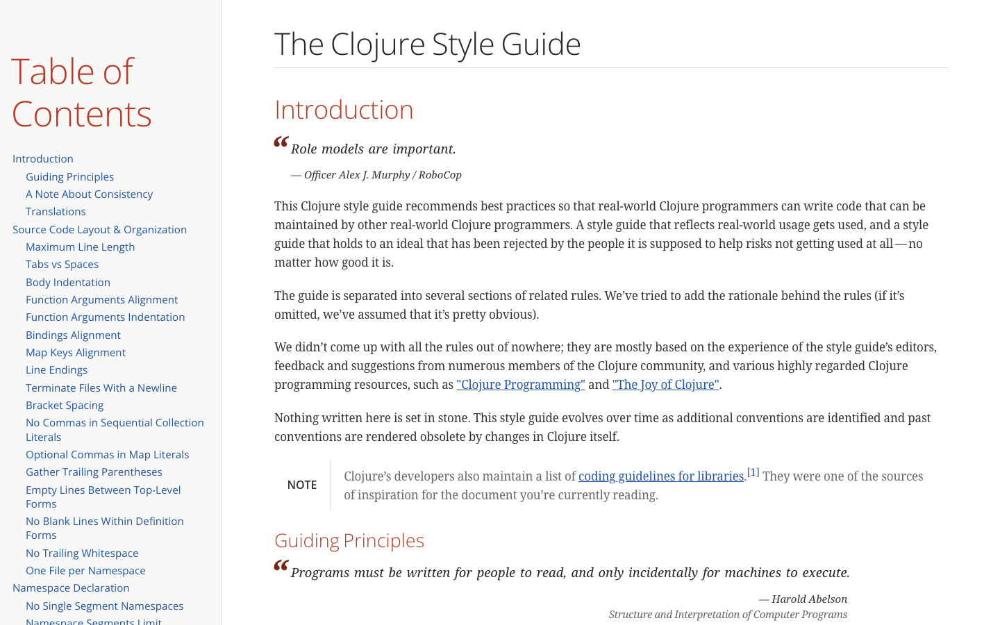
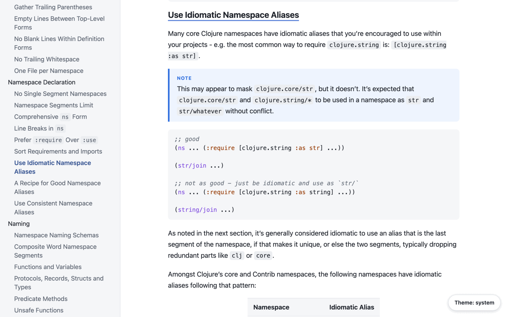
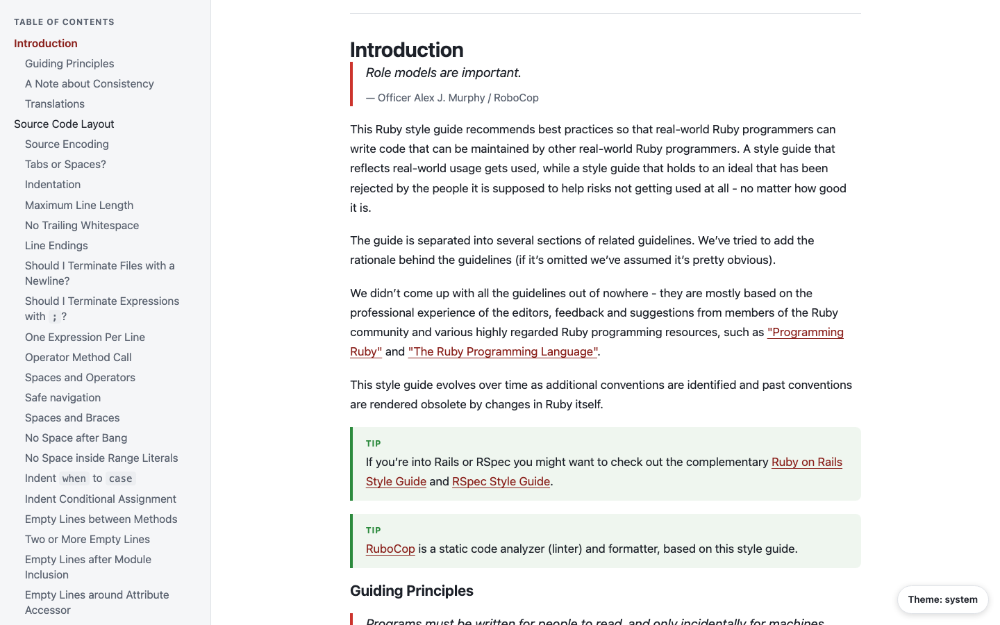
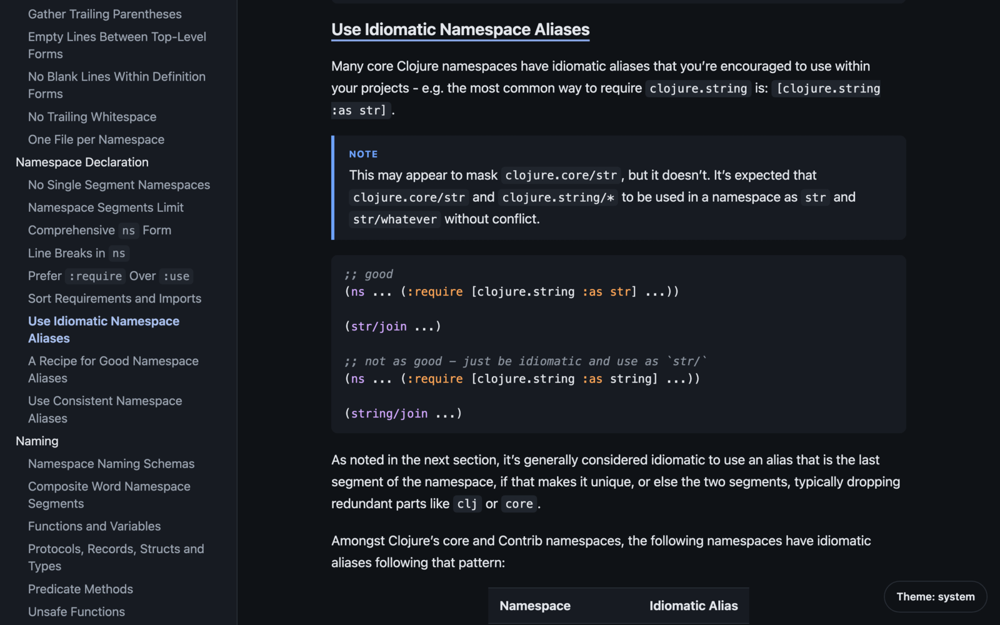
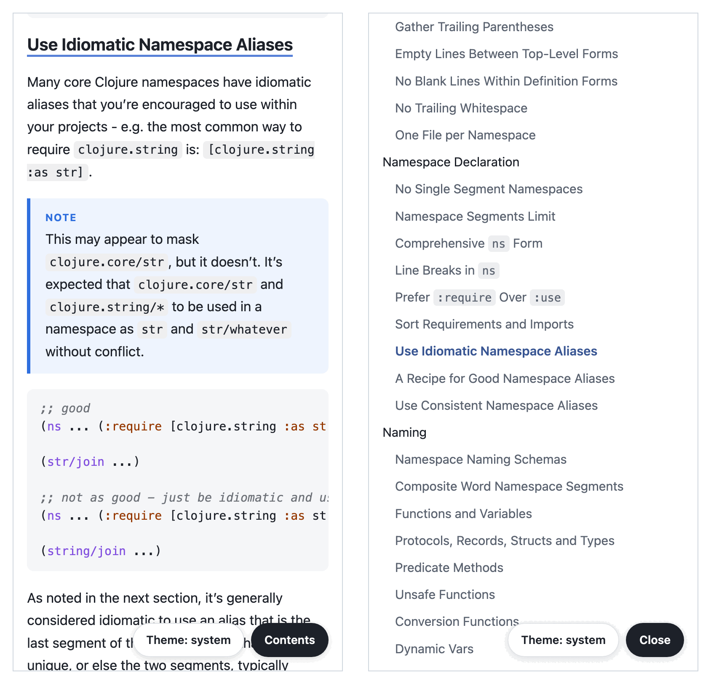

The community style guides for [Ruby](https://rubystyle.guide) and
[Clojure](https://guide.clojure.style) (and their siblings for
[Rails](https://rails.rubystyle.guide), [RSpec](https://rspec.rubystyle.guide) and
[Minitest](https://minitest.rubystyle.guide)) got a brand new look this week.
That was long overdue and, as it turned out, way easier to do than I had
expected.

<!--more-->

## A Bit of History

Back in 2019 I spent a lot of time [converting the guides from Markdown to AsciiDoc]()
and publishing them as websites for the first time. It's no secret that I'm a big fan
of AsciiDoc and I think it's the best format for writing technical documentation.
I've written about it [here](),
[there](https://batsov.com/articles/2024/02/22/asciidoc-language-specification/) and
[everywhere](https://batsov.com/articles/2026/06/11/emacs-loves-asciidoc/), and
the documentation of most of my bigger OSS projects is written in AsciiDoc.

Admittedly, I didn't think much about the websites back then. Each guide is just a single
`README.adoc`, so I went with the simplest approach I could find:

```shell
asciidoctor -a toc="left" -a toclevels=2 README.adoc -o _build/html/index.html
```

Yeah, that's the entire "site generator". A CI job would run this command on
every push and publish the resulting `index.html` to GitHub Pages. At the time
I wrote that [it's much better to have great content than beautiful visuals]()
(although having them both would be ideal for sure) and I was certain that I'd
replace this setup with something fancier down the road. Fast-forward 7 years
and it was still there.[^1] Time sure flies fast!

## The Problem

Here's what the guides looked like until a few days ago:



That's Asciidoctor's default stylesheet. It was fine in 2019, but it hasn't aged
that well, and over the years I've heard a few complaints about it:

* On a phone the entire table of contents is displayed at the top of the page.
  The Ruby guide has over 300 entries there, so you had to scroll for quite a
  while before you'd get to the actual content.
* There's no dark mode.
* The tables [look like something from mid-1990s web pages](https://github.com/bbatsov/clojure-style-guide/issues/277).
  That's a pretty accurate description, if you ask me.
* The fonts are fetched from Google Fonts, which is a bit weird for a page
  that's otherwise a single self-contained HTML file.

Thanks to [Jun Kawai](https://github.com/kwj) for bringing up the tables
recently! That was the nudge I needed to finally do something about the looks
of the guides.

From time to time I've considered moving the guides to
[Antora](https://antora.org) (which I'm using for the documentation of CIDER,
nREPL and RuboCop) or some other static site generator, but that always seemed
like an overkill to me. After all, each guide is a single document, right?

## The Fix

In the end I didn't need a different tool at all - I only needed a different
stylesheet. Asciidoctor allows you to replace its default stylesheet with your
own and to inject some HTML of yours into the page (that's what the `docinfo`
attributes are for). Basically, the command above became:

```shell
asciidoctor -a toc=left -a toclevels=2 \
  -a stylesdir=theme -a stylesheet=guide.css \
  -a docinfo=shared -a docinfodir=theme \
  -a guide-accent='#cc342d' \
  README.adoc -o _build/html/index.html
```

The output is still a single self-contained HTML file and I didn't have to
touch the AsciiDoc source of the guides at all. I was pretty glad that getting
where I wanted to go was just a matter of using a different stylesheet. Here's
how the guides look today:





There's a dark mode that follows your system settings (you can also switch
between the modes manually):



And on small screens the table of contents is no longer in your way:



The sidebar also highlights the section that you're currently reading, which is
pretty handy for documents that long.

## The Look

I'm no designer (as you can probably tell), so I didn't try to come up with
something original. I assume that most people reading the guides spend a lot of
time on GitHub, so I aimed for something aligned with GitHub's UI - the greys,
the borders, the admonitions and the syntax highlighting are all pretty close
to what you'd see there in light and dark mode. The theme relies on your system
fonts, so nothing gets downloaded anymore.

The only difference between the guides is the accent colour. Each
guide specifies a single colour (Clojure's blue and Ruby's red) and everything
else is derived from it in CSS:

```css
--accent: light-dark(var(--brand), color-mix(in oklch, var(--brand), white 30%));
--link: light-dark(color-mix(in oklch, var(--brand), black 25%),
                   color-mix(in oklch, var(--brand), white 50%));
```

In other words - the links are a darker shade of the accent on a light
background and a lighter shade of it on a dark background, so they are easy to
read in both modes. Modern CSS is pretty awesome! Not so long ago you'd need a
preprocessor for something like this.[^2]

## One Theme to Rule Them All

All the guides share the same theme, which lives in a [separate
repository](https://github.com/bbatsov/style-guide-theme). It's just a
stylesheet, a little bit of JavaScript (for the theme switcher and the mobile
menu) and a GitHub Action that wraps the command you saw earlier. Here's all
that it takes to build a guide now:

```yaml
- uses: actions/checkout@v7
- uses: bbatsov/style-guide-theme@v1
  with:
    accent: '#5881d8'
```

While I was at it I also moved the Ruby guides from CircleCI to GitHub Actions,
so now all the guides are built and deployed in exactly the same way. There's
nothing specific to style guides in the theme, so feel free to use it for your
own AsciiDoc documents if you like it.

## Epilogue

I'm sure that the new look has some rough edges. I haven't tested it on that
many browsers and devices, and I guess that not everyone will like my choice of
colours. If you notice any problems - please, let me know! Issues and pull
requests are always welcome!

Looking back, I'm glad I went with something that simple in 2019. I never
expected it'd stay in place for so many years, but simple solutions are also
the easiest to improve when the time for this finally comes. Once again I was
reminded that "less is more".

That's all I have for you today. Keep hacking!

[^1]: There's nothing more permanent than a temporary solution.
[^2]: The downside is that the theme requires a browser released in 2024 or later.
